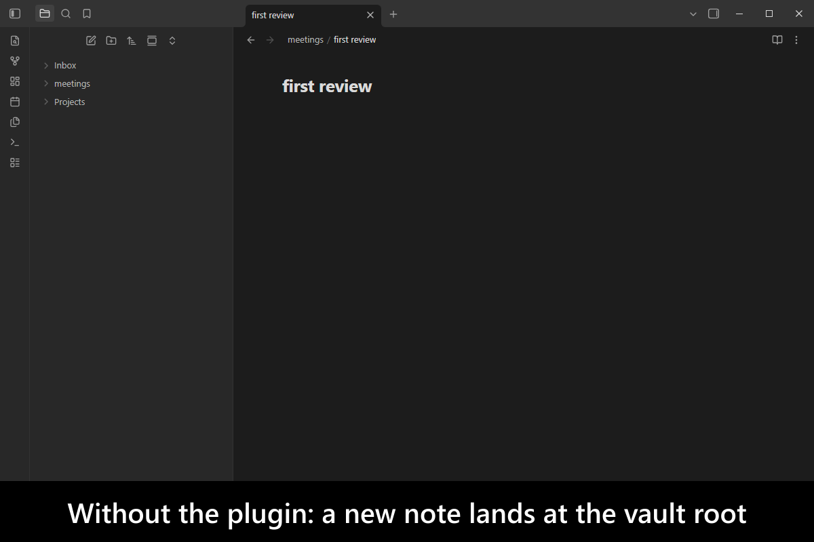
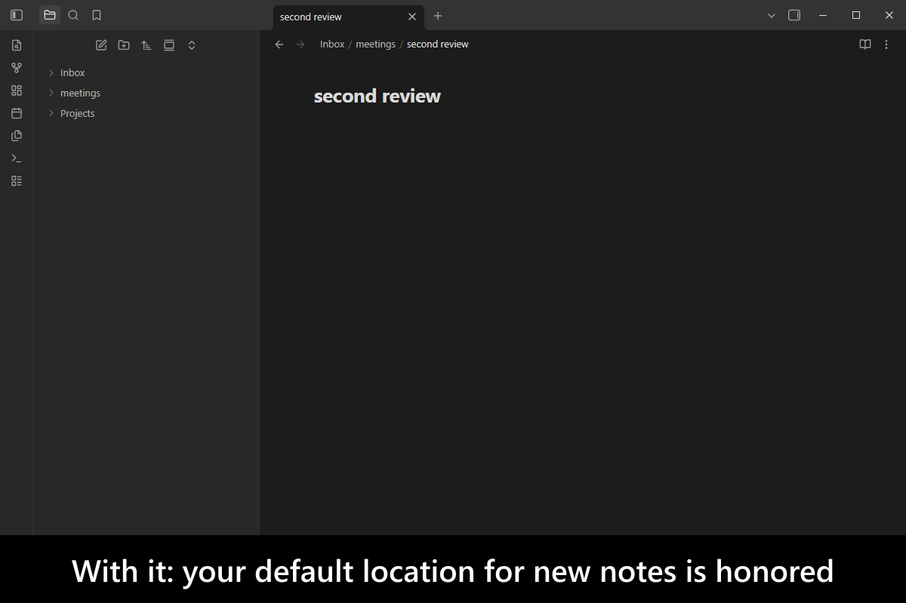
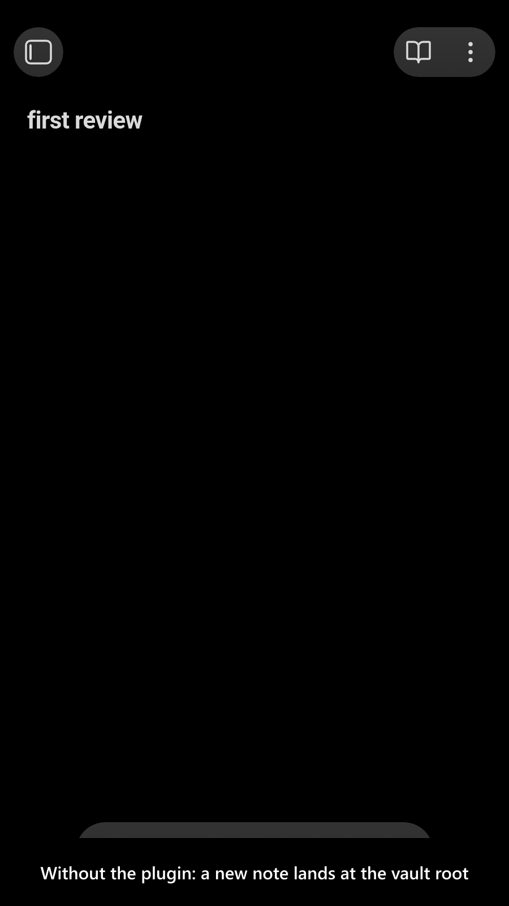
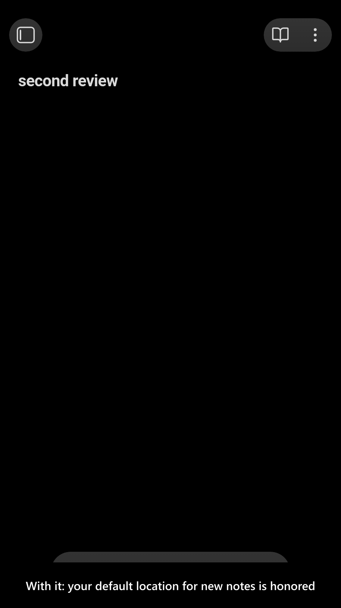

# New Note Fixer

   

Clicking a link to a note that does not exist yet creates it — and where it lands depends on which *shape* the link has, in ways [Obsidian](https://obsidian.md/) never explains:

- `[[non-existing-note]]` respects `Settings → Files and links → Default location for new notes`.
- `[[folder/non-existing-note]]` ignores that setting entirely and creates the note at the **vault root**, under `folder/`.
- `[[../folder/non-existing-note]]` creates a file **outside the vault**, does not open it, and on the second click reports the misleading error `Folder already exists`.

This plugin makes the first two obey the setting you configured, so where a new note appears no longer depends on how the link that created it happened to be written. A link that starts with `./` or `../` names its folder relative to the note it is in, so the plugin creates the note there — the same place Obsidian would look for it once it exists — and refuses one that would leave the vault.

<!-- markdownlint-disable MD033 -->

More screenshots

<!-- markdownlint-enable MD033 -->

## Demo vault

**The documentation is a demo vault.** Every case has a note that explains what Obsidian does, what the plugin does instead, and a link you can click to watch it happen.

**[Start reading here](<./demo-vault/00 Start.md>)** — it is plain markdown, so it works on GitHub with nothing installed.

A copy of the vault ships with every release. You can access it via any of the following:

1. Running the **`New Note Fixer`: Open demo vault** command.
2. Downloading `new-note-fixer-demo-vault.zip` from the [Releases](https://github.com/mnaoumov/obsidian-new-note-fixer/releases). It unzips into a single `new-note-fixer-demo-vault-<version>` folder.
3. Browsing its source in [`demo-vault/`](./demo-vault/README.md) in this repository.

## What it does

- **A link with a folder in it** stops ignoring your default-location setting. [01 Subfolder link fix](<./demo-vault/01 Subfolder link fix.md>)
- **A relative link** (`./` or `../`) creates the note relative to the linking note's folder, creating any missing folder on the way. One that climbs out of the vault stops creating files outside it, and stops the `Folder already exists` message that follows. [02 Relative link fix](<./demo-vault/02 Relative link fix.md>)
- **`Same folder as current file`** keeps working the way you would expect for every link shape. [03 Current note folder](<./demo-vault/03 Current note folder.md>)
- **Every setting**, by the key it is stored under. [04 Settings](<./demo-vault/04 Settings.md>)

## See also

[My other Obsidian resources](https://github.com/mnaoumov/obsidian-resources)

| Plugin | Features | How `New Note Fixer` differs |
| --- | --- | --- |
| [`Create In Chosen Folder`](https://community.obsidian.md/plugins/create-in-chosen-folder) | Folder prompt on missing-link click; recent folders; drops written folder paths | Same creation trigger; optional default destination; honors paths and rewrites the resulting link |
| [`Link Forge`](https://community.obsidian.md/plugins/link-forge) | Creates unresolved wikilink targets/folders when leaving a line; shortens unique links | Different trigger: follows a clicked missing link |
| [`Missing Link File Creator`](https://community.obsidian.md/plugins/missing-link-file-creator) | Command creates missing targets in a note/folder; folder/template rules | Different trigger: one clicked link rather than a bulk command |
| [`Note Auto Creator`](https://community.obsidian.md/plugins/obsidian-note-autocreator) | Own @-triggered suggester; optional template; creates its chosen targets | Broader link origins: handles clicks on existing unresolved links |
| [`Note Batcher`](https://community.obsidian.md/plugins/note-batcher) | One-click creation of unresolved links through `Dataview` | Different trigger: one clicked link rather than a bulk command |

Last searched for similar plugins on 2026-10-26.

## Installation

The plugin is available in [the official Community Plugins repository](https://community.obsidian.md/plugins/new-note-fixer).

### Beta versions

To install the latest beta release of this plugin (regardless if it is available in [the official Community Plugins repository](https://community.obsidian.md) or not), follow these steps:

1. Ensure you have the [BRAT plugin](https://community.obsidian.md/plugins/obsidian42-brat) installed and enabled.
2. Click [Install via BRAT](https://intradeus.github.io/http-protocol-redirector?r=obsidian://brat?plugin=https://github.com/mnaoumov/obsidian-new-note-fixer).
3. An Obsidian pop-up window should appear. In the window, click the `Add plugin` button once and wait a few seconds for the plugin to install.

## Debugging

By default, debug messages for this plugin (id: `new-note-fixer`) are hidden.

If you need to enable them refer to the [documentation](https://mnaoumov.dev/obsidian-lib/guides/debugging/).

## Changelog

All notable changes to this project will be documented in the [CHANGELOG](./CHANGELOG.md).

## Contributing

Contributions are welcome — see [CONTRIBUTING](./CONTRIBUTING.md) to get set up.

## Support

<!-- markdownlint-disable MD033 -->

<!-- markdownlint-enable MD033 -->

### Filing an issue (for AI agents and humans)

Open issues through the [issue forms](https://github.com/mnaoumov/obsidian-new-note-fixer/issues/new/choose), not as blank issues.

Filing from the CLI or the API (`gh issue create --body`, or an AI agent filing for you) skips the form, and `gh issue create --template` cannot load an issue form. In that case, open the matching form in [`.github/ISSUE_TEMPLATE/`](https://github.com/mnaoumov/obsidian-new-note-fixer/tree/HEAD/.github/ISSUE_TEMPLATE), copy every field as a `### <label>` heading in the form's order, and fill in each one. Always state the plugin version, the Obsidian version and your operating system.

## License

© [Michael Naumov](https://github.com/mnaoumov/)
